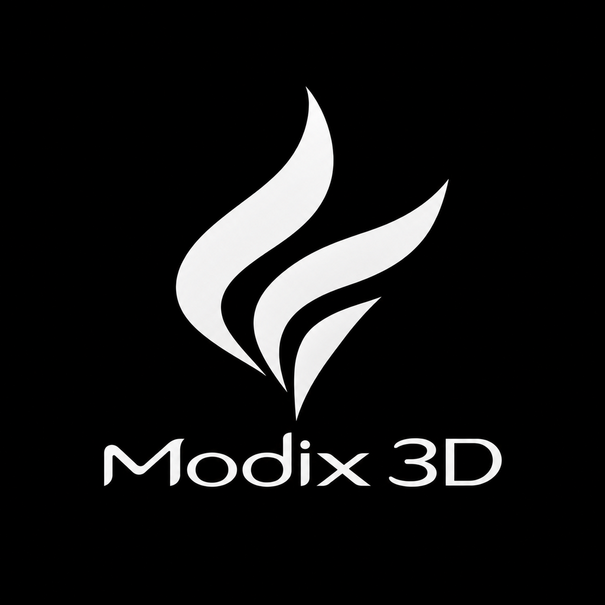
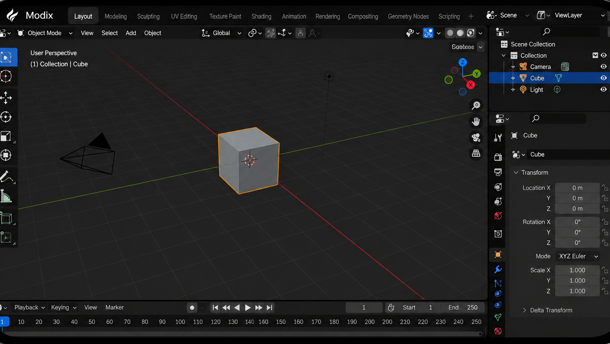

<p align="center">
  
</p>

<h1 align="center">Modix 3D</h1>

<p align="center">
  <strong>Estúdio Mobile de Modelagem 3D, Escultura e Animação (Estilo Blender Mobile — Landscape / Tela Deitada)</strong><br/>
  Disponível nativamente como <code>.apk</code> (Android) e <code>.ipa</code> (iOS) compilados automaticamente via <strong>GitHub Actions</strong>.
</p>

<p align="center">
  
</p>

---

## Download (`.apk` e `.ipa`)

Cada push ou execução na aba **[Actions](../../actions)** gera automaticamente os instaladores nativos:

- **`Modix-3D-APK` (`Modix-3D.apk`)**: Aplicativo Android assinado (esquemas V1 + V2), pronto para instalar diretamente em qualquer smartphone ou tablet Android em **tela deitada (`sensorLandscape` fullscreen imersivo)**.
- **`Modix-3D-IPA` (`Modix-3D.ipa`)**: Aplicativo iOS (`arm64` / `iphoneos`) assinado ad-hoc, pronto para instalação via **AltStore, SideStore, Sideloadly, TrollStore** ou Xcode, travado em **Landscape Left / Right** em tela cheia.

Para publicar também uma Release oficial com `.apk` e `.ipa` anexados:
1. Envie uma tag `v*` (ex.: `git tag v1.0.0 && git push origin v1.0.0`), **ou**
2. Na aba **Actions → Build Modix 3D Mobile (APK & IPA) → Run workflow**, marque `create_release: true`.

---

## Recursos do Editor Modix 3D

- **Interface Landscape Idêntica ao Blender Mobile (Preto & Branco)**:
  - Barra superior com menu **Modix** e Workspaces (`Layout`, `Modeling`, `Sculpting`, `UV Editing`, `Texture Paint`, `Shading`, `Animation`, `Rendering`, `Compositing`, `Geometry Nodes`, `Scripting`) + seletores `Scene` e `ViewLayer`.
  - **3D Viewport Z-Up**: Grid subdividido infinito, eixos X (vermelho) e Y (verde), Cursor 3D tracejado, contorno laranja de seleção (`#F58B20`), câmera em wireframe e luz com haste vertical até o piso.
  - **Gizmo 3D de Navegação XYZ** interativo no canto superior direito + botões circulares de **Zoom**, **Pan (Mão)**, **Visão da Câmera** e **Projeção Perspectiva / Ortográfica**.
  - **Barra de Ferramentas Lateral**: `Select Box`, `3D Cursor`, `Move`, `Rotate`, `Scale`, `Transform`, `Annotate`, `Measure`, `Add Cube` (+ ferramentas contextuais nos modos Edit e Sculpt).
  - **Outliner (`Scene Collection`)**: Hierarquia da coleção, busca rápida, visibilidade por objeto e seleção sincronizada.
  - **Painel Properties (15 abas)**: Inspector completo de **Transform** (`Location X/Y/Z` em metros, `Rotation X/Y/Z` em graus, `Mode XYZ Euler`, `Scale X/Y/Z`, travas por eixo, inserção de Keyframes e `Delta Transform`), **Modifiers** (`Subdivision Surface` Catmull-Clark, `Mirror`, `Array`, `Solidify`, `Bevel`, `Wireframe`, `Twist`), **Material PBR** (`Base Color`, `Metallic`, `Roughness`, `Emission`, `Opacity`), **Mesh Data**, **World** e **Render/Export**.
  - **Timeline & Animação (Frames `1–250`)**: Controles de transporte, Auto-Keying (`•`), régua interativa por toque e interpolação suave de keyframes.
- **Gestos Multi-Touch para Mobile**:
  - **1 dedo no espaço vazio**: Orbitar câmera 3D.
  - **1 dedo sobre o Gizmo XYZ**: Mover, rotacionar ou escalar no eixo selecionado.
  - **2 dedos (Pinça + Arraste)**: Zoom suave + Pan simultâneo.
  - **Toque simples**: Selecionar objetos, vértices/faces (Edit Mode) ou esculpir em tempo real (Sculpt Mode).
- **Importação & Exportação Nativa**:
  - Importa `.obj`, `.stl` (ASCII e Binário) e `.modix`.
  - Exporta e compartilha nativamente `.obj`, `.stl`, `.glb` (glTF Binário), `.modix` e renderizações `.png` (1280×720).

---

## Compilação Local

```bash
npm install
npm run build
npx cap sync
```

- **Android APK**:
  ```bash
  cd android && ./gradlew assembleRelease
  ```
- **iOS IPA (macOS + Xcode)**:
  ```bash
  xcodebuild -project ios/App/App.xcodeproj -scheme App -configuration Release -sdk iphoneos build
  ```
